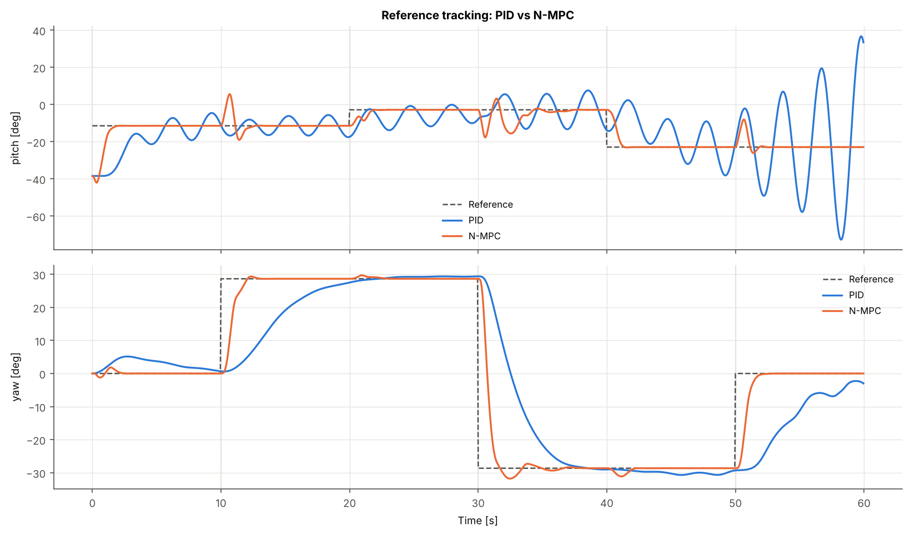

# Comparison of Reference Tracking Performances of N-MPC and PID Controllers in Twin Rotor (TRMS) Systems

Python simulation study of a Feedback Instruments **TRMS 33-220**. The plant is a full
nonlinear 6-state model. The study compares two controllers on the same reference-tracking task:

* a decentralised **PID** (pitch from the main rotor, yaw from the tail rotor), and
* a **Nonlinear Model Predictive Controller** (CasADi + IPOPT, multiple shooting).

Both controllers are **auto-tuned** with the same objective and the same optimiser
family. The tuned parameters are **cached** in `config/tuned_parameters.json`.
Every run writes complete telemetry, metrics and figures for each controller,
plus a root-level comparison.

---

## 1. Quick start

```bash
git clone https://github.com/aybarsavci/TRMS-Kontrol.git
cd TRMS-Kontrol
python -m venv .venv
# Windows: .venv\Scripts\activate      Linux/macOS: source .venv/bin/activate
pip install -r requirements.txt

python main.py                 # uses the cached tuned parameters (≈30 s)
python main.py --retune all    # re-optimise both controllers, then simulate
python main.py --retune pid    # re-optimise only the PID (or: --retune nmpc)
python main.py --quick         # small search budget, for a smoke test only
python main.py --controllers nmpc   # only the N-MPC (no PID, no comparison files)
python tests/test_core.py      # regression tests (or: python -m pytest tests/)
```

The cached parameters are reused only while their **signature** still matches. The
signature is a SHA-256 hash of the model parameters, sample time, tuning
scenario, objective, controller settings and search budget. If you edit any of
these in `config/settings.yaml`, the affected controller is re-tuned
automatically on the next run.

Typical tuning time: PID ≈ 2–3 min (vectorised population). N-MPC ≈ 10–20 min,
depending on the number of CPU cores, because each candidate is a full
closed-loop IPOPT simulation and candidates run in parallel processes.
Measured on a 2-core machine: PID 142 s, N-MPC 1,181 s (see *Performance* in §6).

## 2. Repository layout

```
TRMS-Kontrol/
├── main.py                      entry point (tune → simulate → log → plot → compare)
├── requirements.txt
├── config/
│   ├── settings.yaml            all experiment settings (scenarios, objective, bounds, budgets)
│   └── tuned_parameters.json    cache of optimised PID gains and N-MPC Q/R/N (+ tuning reports)
├── trms/
│   ├── params.py                TRMS 33-220 physical parameters (source + errata noted)
│   ├── model.py                 nonlinear dynamics (numpy batched + CasADi symbolic), RK4, trim
│   ├── scenario.py              reference step scenarios and step segmentation
│   ├── controllers/
│   │   ├── pid.py               discrete PID, filtered derivative, anti-windup (vectorised core)
│   │   └── nmpc.py              CasADi/IPOPT N-MPC, cached solver per horizon, shifted warm start
│   ├── tuning.py                differential-evolution auto-tuning for both controllers
│   ├── cache.py                 signature-checked JSON parameter cache
│   ├── simulation.py            closed-loop simulation with exhaustive telemetry
│   ├── metrics.py               step metrics, whole-run metrics, shared tuning objective
│   ├── plotting.py              per-controller and comparison figures
│   └── reporting.py             CSV / JSON / NPZ / Excel / Markdown writers
├── tests/test_core.py           regression tests (bit-identical plant, bug fixes, cache)
└── docs/results/                figures and summary from the reference run
```

## 3. Output structure (created on every run)

```
outputs/run_YYYYmmdd-HHMMSS/
├── PID/
│   ├── telemetry.csv              one row per sample (see list below)
│   ├── step_metrics.csv           overshoot, rise/settling time, SSE, IAE/ISE/ITAE, coupling per step
│   ├── global_metrics.csv / .json whole-run error, effort, smoothness, compute time
│   ├── controller_parameters.json final gains + full tuning report
│   ├── 00_tuning_convergence.png … 10_trim_envelope.png
│   └── README.txt
├── N-MPC/
│   ├── (same files as PID)
│   ├── nmpc_predictions.npz       predicted states/inputs/references at every sample
│   ├── 08_nmpc_solver.png         solve time, IPOPT iterations, optimal cost
│   └── 09_nmpc_predictions.png    open-loop predictions along the run
├── comparison_timeseries.csv      both controllers on one time axis
├── comparison_step_metrics.csv    per-step metrics, long format
├── comparison_global_metrics.csv  whole-run metrics side by side
├── comparison.xlsx                sheets: global_metrics, step_side_by_side, step_metrics_long,
│                                  timeseries, telemetry_PID, telemetry_N-MPC, parameters
├── compare_01_tracking.png        reference tracking overlay
├── compare_02_error.png           tracking error overlay
├── compare_03_control_effort.png  inputs + cumulative ∫u² overlay
├── compare_04_cumulative_iae.png
├── compare_05_step_metrics.png    overshoot / settling / rise time / IAE per step
├── compare_06_global_metrics.png
├── summary.md                     human-readable result tables
└── settings_used.yaml             exact settings of this run
```

**Logged per sample (`telemetry.csv`).**

* Time and references (rad and deg).
* All six states and their derivatives.
* Pitch/yaw angles, rates and accelerations.
* Tracking errors.
* Commanded (pre-saturation) and applied inputs, input increments and saturation flags.
* Rotor speeds (rad/s and rpm) and rotor thrusts (N).
* The yaw inertia J_h(α_v).
* Every torque contribution: aerodynamic, gravity, centrifugal and friction on pitch; aerodynamic and friction on yaw.
* Cumulative IAE and ∫u².
* Controller compute time.

**PID-specific columns:** the P, I and D terms and the integrator-frozen (anti-windup) flags.

**N-MPC-specific columns:**

* Solve time and IPOPT iterations.
* Success flag and return status.
* Optimal cost.
* Constraint violation.
* Predicted next and end-of-horizon angles.

## 4. Plant model

State x = [α_v, S_v, u_vv, α_h, S_h, u_hh], input u = [u_v, u_h] ∈ [−1, 1]².

```
dα_v/dt = Ω_v = S_v + J_tr ω_t(u_hh) / J_v
dS_v/dt = [ l_m S_f F_v(ω_m) + g((A−B)cos α_v − C sin α_v) − Ω_h² H sin α_v cos α_v − K_v Ω_v ] / J_v
du_vv/dt = (−u_vv + K_mr u_v) / T_mr
dα_h/dt = Ω_h = S_h + J_mr ω_m(u_vv) cos α_v / J_h(α_v)
dS_h/dt = [ l_t S_f F_h(ω_t) cos α_v − K_h Ω_h ] / J_h(α_v)
du_hh/dt = (−u_hh + K_tr u_h) / T_tr
J_h(α_v) = D cos²α_v + E sin²α_v + F
```

ω_m(·), ω_t(·), F_v(·) and F_h(·) are the 5th/6th-order static rotor characteristics
of the 33-220.

**Source.** The structure (Eq. 30) and all numerical values (Table I and the
polynomials) come from [arXiv:1306.4883](https://arxiv.org/abs/1306.4883),
*"Fault-Tolerant Control of a 2 DOF Helicopter (TRMS System) Based on H∞"*.

**Errata handled.**

* The paper prints the linear coefficient of F_h(ω) as **0.8080**. The code uses
  **0.0801**: the value is printed inconsistently across sources, and 0.8080 makes the tail rotor
  about four times stronger than the main rotor. This value is one line in
  `trms/params.py`; please confirm it against your lab manual.
* The paper's Eq. (18) writes u_vv where the tail state u_hh is meant. The code applies the polynomial to u_hh.

**Reachable pitch range.** With u_v ≤ 1, this parameter set can hold the beam only
between about −1.1 rad and +0.09 rad. The rest position is −0.67 rad. The
reference scenarios therefore stay in −0.45…−0.05 rad. `10_trim_envelope.png`
shows the steady-state input needed for each pitch angle. If your lab's identified
parameters differ, edit `trms/params.py`; the cache then invalidates itself.

The **same equation code** (`trms/model.py::terms`) is evaluated with CasADi
symbols for both the simulated plant (`model.Plant`, RK4 with 10 sub-steps per
sample) and the N-MPC prediction model (RK4 with 2 sub-steps), and with numpy
for the vectorised telemetry and trim calculations. The CasADi plant reproduces
the numpy RK4 bit for bit (`tests/test_core.py`) at about 1/70 of the cost.

`TRMSParams` validates itself on creation: every divisor in the model (J_v,
T_mr, T_tr and J_h(α_v) = D cos²α_v + E sin²α_v + F) is checked to stay positive.

## 5. Controllers

| | PID | N-MPC |
|---|---|---|
| Sample time | 0.05 s | 0.05 s |
| Measurements | pitch and yaw angles | full state (assumed measured/estimated) |
| Structure | two SISO loops; derivative on measurement with a 0.1 s low-pass; anti-windup by conditional integration (the integrator advances at most up to the actuator limit) plus an integrator clamp to the actuator range | min Σ eᵀQe + ΔuᵀRΔu, terminal weight 5×Q, x_{k+1} = RK4(x_k, u_k), u ∈ [−1, 1] |
| Tuned | Kp, Ki, Kd for each axis (6) | Q = diag(q_pitch=1, q_yaw, q_rate_pitch, q_rate_yaw), R = diag(r_pitch, r_yaw), horizon N |
| Reference | current value | current value held over the horizon (`reference_preview: false`) |

Fairness choices:

* Both controllers run at the same rate with the same actuator limits.
* Both are tuned with the same objective on the same tuning scenario.
* The N-MPC is not given knowledge of future reference steps. Setting
  `reference_preview: true` gives it that preview, but this is an advantage the PID does not have.

## 6. Auto-tuning

Both controllers minimise the **same** cost on a **tuning scenario**. The tuning
scenario differs from the evaluation scenario, so neither controller is scored
on the exact trajectory it was fitted to.

```
J = ITAE_pitch + ITAE_yaw + 0.02·(TV(u_pitch) + TV(u_yaw))
    + 0.05·Σ_steps max(0, overshoot% − 5)
    [+ 1000 if |pitch| > 1.4 rad or |yaw error| > 1.5 rad]
```

ITAE measures time from the **latest reference change**. Error that persists,
such as slow drift or a limit cycle, therefore costs far more than a fast transient.
A first version used plain IAE and a pitch-only divergence check. With those, the PID optimiser
found near-zero yaw gains whose slow drift stayed hidden in the tuning window
but ran away over a longer run. The tuning scenario also ends with a long
hold for the same reason.

* **PID.** `scipy.optimize.differential_evolution` over log10 of the six gains.
  The whole population is simulated in a single vectorised numpy pass, which is far faster than
  evaluating candidates one by one.
* **N-MPC.** `differential_evolution` over log10 of the five free weights plus an
  integer horizon N ∈ [15, 40] (using `integrality`). Each candidate is a full
  closed-loop IPOPT run, and candidates are evaluated in parallel worker processes.
  IPOPT is warm-started from the shifted previous solution and its multipliers
  with an adaptive barrier, which roughly halves the solve time.

Search bounds, population size, iteration counts and seeds are in
`config/settings.yaml`. The convergence history of each tuning run is stored in
the cache and plotted as `00_tuning_convergence.png`.

### Performance

Measured on the same 2-core machine, same settings and seeds, before and after
the optimisation pass of 2026-10-14:

| Stage | Before | After | Speed-up |
|---|---|---|---|
| PID evaluation run (1,200 samples, full telemetry) | 5.0 s | 0.1–0.2 s | ≈ 30× |
| N-MPC evaluation run (1,200 IPOPT solves) | 20.2 s | 13.7 s | 1.5× |
| `python main.py` end to end (cached parameters) | 40.5 s | 28.0 s | 1.4× |
| One PID tuning generation (128 candidates) | 4.3 s | 1.14 s | 3.8× |
| PID auto-tuning (121 generations) | 519 s | 142 s | 3.7× |
| N-MPC auto-tuning (7 generations, 2 workers) | 2,039 s | 1,181 s | 1.7× |

Where the time went and what changed:

* **Plant integration.** The numpy RK4 made ~40 small-array calls per sample (3 ms).
  `model.Plant` evaluates the same equations as one CasADi SX function (~40 µs,
  bit-identical results); populations use `Function.map`.
* **Telemetry.** Buffers are pre-allocated; derived quantities (derivatives, rotor
  speeds, torques, running integrals) are computed once, vectorised over the whole
  trajectory, instead of per sample.
* **N-MPC solver reuse.** The Q/R weights are NLP parameters, so one solver (graph,
  exact derivatives, IPOPT instance) is built per horizon N and reused. Tuning
  previously rebuilt it for every candidate.
* **N-MPC warm start.** Primal guess and multipliers are now shifted consistently
  (the multipliers used to be passed unshifted): 9 % fewer IPOPT iterations.
* **Not adopted, measured:** JIT-compiling the NLP to C (162 s compile per horizon
  for a 25 % faster solve), stage-interleaved variable ordering (no gain) and
  CasADi's FATROP solver (did not converge on this problem). The remaining solve
  time is IPOPT's own per-iteration work.

## 7. Metrics

* **Per step** (each step's window ends at the next reference change on either axis):
  * overshoot % and undershoot %;
  * 10–90 % rise time and 50 % delay time;
  * 2 % settling time, or "not settled" if the response never stays inside the band;
  * steady-state error (mean over the last 1 s);
  * IAE, ISE and ITAE;
  * peak deviation of the other axis (cross-coupling).
* **Whole run:**
  * IAE, ISE, ITAE, RMSE and maximum error per axis;
  * ∫u², ∫|u|, total variation and maximum |Δu| of the inputs;
  * saturation fraction;
  * controller compute time: mean, median, p95, max, and the share of samples over the real-time budget.

## 8. Reference results

These come from a full-budget run: `python main.py --retune all`, then a cached rerun. The figures are in `docs/results/`.



| Metric (60 s evaluation scenario) | PID | N-MPC |
|---|---|---|
| IAE pitch / yaw [rad·s] | 10.2 / 8.29 | 1.88 / 1.87 |
| RMSE pitch / yaw [rad] | 0.248 / 0.246 | 0.087 / 0.124 |
| Steps settled within 2 % (pitch / yaw) | 0 of 3 / 1 of 3 | 3 of 3 / 3 of 3 |
| Mean overshoot pitch / yaw [%] | 44.5 / 0.2 | 0.6 / 2.6 |
| Control effort ∫u² | 25.4 | 33.7 |
| Input total variation | 11.0 | 44.6 |
| Compute time mean / max [ms] (Ts = 50 ms) | 0.06 / < 1 | 11–16 / 110–310 (varies by run) |

**Tuned parameters** (in `config/tuned_parameters.json`):

* **PID:** Kp, Ki, Kd = 0.456, 0.396, 0.132 (pitch) and 0.181, 0.001, 0.651 (yaw).
* **N-MPC:** N = 38 (1.9 s), Q = diag(1, 3.05, 0.0042, 0.343), R = diag(0.0128, 0.352).

**Reading the results.**

* **PID pitch.** The pitch axis is a very lightly damped pendulum (ζ ≈ 0.04) behind
  a 1.4 s motor lag, and the rotor thrust gain varies about 2× across the
  reachable pitch range. The best fixed-gain PID the optimiser found has three properties:
  * it oscillates around −0.2 rad;
  * it becomes unstable at −0.4 rad, where the loop gain is highest;
  * it settles the yaw reversal in 7 s.

  A 4,000-sample random search over the pitch gains found nothing better.
  The PID's lower effort and input variation follow from the same slow,
  lightly damped behaviour.
* **N-MPC.** It settles every step in about 1.3–4 s with small overshoot. The cost is
  bang-bang-like inputs (pitch input saturated 19 % of the time) and more effort.
* **Cross-coupling.** Each yaw step disturbs the N-MPC's pitch by up to about 17°. This is the
  tail rotor's reaction torque, which acts directly on pitch rate. It is reported per step as
  `cross_coupling_peak_dev_deg`.
* **Real-time margin.** IPOPT averages about 11–16 ms per 50 ms sample, but its slowest
  sample took 110–310 ms in repeated runs (wall-clock time varies; trajectories and
  iteration counts are identical). About 1–1.5 % of samples exceeded the budget
  (`realtime_budget_exceeded_fraction` in `global_metrics.json`).
  Real-time use on hardware would need a capped iteration count or a real-time
  iteration scheme.
* **Search bound.** Ki_yaw reached the lower search bound (10⁻³). The yaw loop
  behaves essentially as PD; widening the bound is a one-line change in the settings.

**Limitations.**

* Simulation only.
* The N-MPC gets the exact plant model and the full state, with no noise, model
  mismatch or state estimator. Real hardware will narrow the gap.
* The PID is a pure decentralised PID, as specified. It has no gravity
  feed-forward or gain scheduling, which are the usual TRMS additions.

## 9. Version control

These are the commands used to publish this project to
<https://github.com/aybarsavci/TRMS-Kontrol>:

```bash
git clone https://github.com/aybarsavci/TRMS-Kontrol.git && cd TRMS-Kontrol
# (add the files of this repository)
git add .gitignore requirements.txt config/settings.yaml trms/__init__.py trms/params.py
git commit -m "chore: scaffold TRMS N-MPC vs PID project" -m "Add dependency list, ignore rules, experiment settings and TRMS 33-220 parameter set (arXiv:1306.4883, Table I) with documented errata."
git add trms/model.py trms/scenario.py
git commit -m "feat(model): nonlinear 6-state TRMS model and reference scenarios" -m "Single equation source evaluated with numpy (batched) for the plant and CasADi for prediction; RK4 integration, trim and reachable-pitch envelope; step scenarios segmented per reference change."
git add trms/controllers/
git commit -m "feat(control): discrete PID and CasADi/IPOPT N-MPC" -m "PID with filtered derivative on measurement and conditional-integration anti-windup (vectorised core). N-MPC with multiple shooting, input bounds, du penalty, terminal weight and warm-started IPOPT."
git add trms/metrics.py trms/tuning.py trms/cache.py
git commit -m "feat(tuning): differential-evolution auto-tuning with persistent cache" -m "Shared objective (IAE + input TV + overshoot + divergence) for both controllers; vectorised PID population, parallel N-MPC search with integer horizon; SHA-256 signature invalidates stale JSON cache."
git add trms/simulation.py trms/plotting.py trms/reporting.py main.py
git commit -m "feat(sim): closed-loop simulation, exhaustive logging and comparison reports" -m "Per-controller PID/ and N-MPC/ folders with telemetry, step and global metrics, figures and N-MPC predictions; root-level CSV/Excel comparison, overlay plots and Markdown summary. CLI with --retune and --quick."
git add README.md docs/ config/tuned_parameters.json
git commit -m "docs: README, reference results and tuned parameter cache" -m "Document model, errata, controllers, tuning, outputs and usage; include the full-budget tuned parameters so a fresh clone runs without re-tuning."
git push origin main
```
